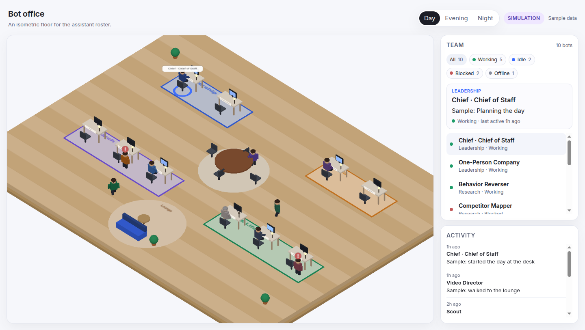

# Bot office

An isometric office for the assistant roster. Each bot is a low-poly avatar on a shared floor. Its status decides where it stands: typing at a desk, blocked beside that desk, wandering the lounge, or sitting greyed-out with the lamp off.



## Run locally

```bash
npm i && npm run dev
```

The dev server prints a local URL. `npm run build` writes a static site to `dist/` (no backend).

The page shipped in this repo reads `public/status.json`, which is sample data. Simulation mode is the default in that case: a **Simulation** badge stays visible, statuses rotate every few seconds, and new activity lines are generic placeholders.

## Feed

The page polls a status file every 15 seconds.

- Default: `status.json` next to the page.
- Override: `?feed=<url>` (the URL must allow the browser to read it).

```json
{
  "generated_at": "2026-11-12T00:00:00Z",
  "bots": [
    {
      "id": "scout",
      "name": "Scout",
      "zone": "Research",
      "status": "working",
      "task": "Reviewing notes",
      "last_active": "2026-11-12T00:00:00Z"
    }
  ],
  "activity": [
    { "ts": "2026-11-12T00:00:00Z", "bot_id": "scout", "text": "Back at the desk" }
  ]
}
```

`status` is one of `working`, `idle`, `blocked`, `offline`.

| Status | What the avatar does |
| --- | --- |
| `working` | Sits at its desk, types, monitor glows. A task that mentions a meeting, sync, huddle, or the table sends it to the meeting table instead. |
| `idle` | Walks to the lounge and wanders. |
| `blocked` | Stands at its desk with a red `!`. |
| `offline` | Sits greyed-out. The desk lamp and monitor stay off. |

If the payload has `"source": "sample"` or a notice that says sample, the page stays in simulation mode. Drop that marker when the file is a real feed. The seed roster lives in `public/status.sample.json` and lists the same ten bots: Chief · Chief of Staff, One-Person Company, Scout, Competitor Mapper, Behavior Reverser, Explainer Video bot, Video Director, Selling, Tax Desk, and Get Hired 2027. Zones are Leadership, Research, Media, and Ops & Life. Adding a bot to the feed gives it the next desk in its zone.

Hover or click an avatar, or a row in the Team panel, to highlight it and read the name, zone, task, and last-active time. Day, Evening, and Night only change the lighting. Below about 900px the Team panel stacks under the floor.

## Exporter

`tools/export_status.py` is where a live feed can plug in later. It writes `status.json` from a local YAML or JSON roster plus optional overrides:

```bash
python tools/export_status.py \
  --roster tools/roster.sample.yaml \
  --overrides tools/overrides.sample.json \
  --out public/status.json
```

It keeps bot names, zones, a coarse status, a short task label, and timestamps. It refuses message content, emails, and secret-shaped values instead of copying them through. Swap `load_roster` for a live client and keep `build_status` as the gate.

## Tests

```bash
npm test
pytest
```

GitHub Actions runs both, plus `npm run build`.

## Privacy

The office shows names, zones, coarse status, short task labels, and timestamps. It is not a place for message bodies, email, or other personal data. Sample files are labelled sample, and simulation mode is badged so they are not read as a live roster.
